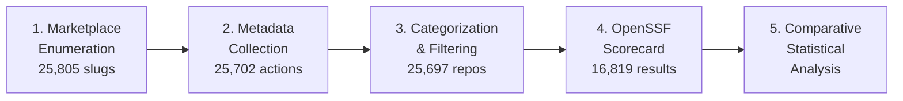
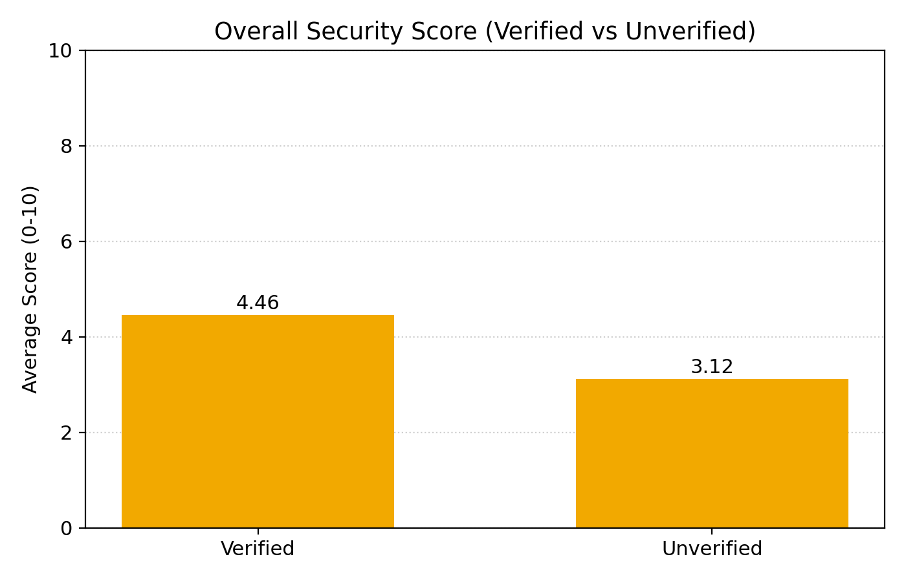
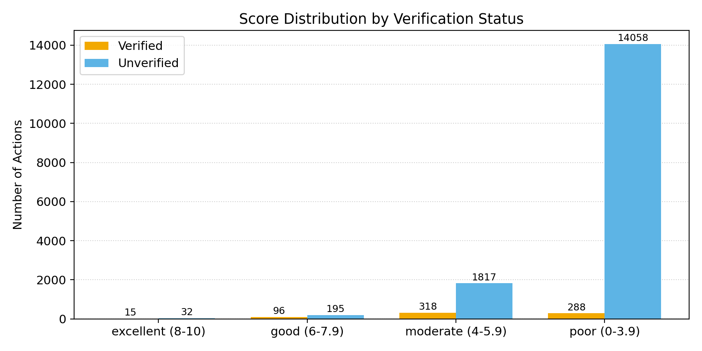
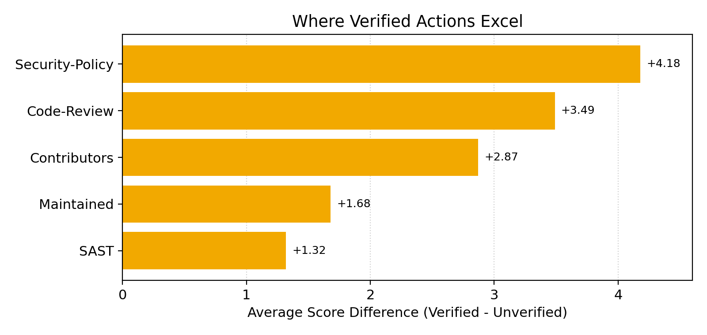
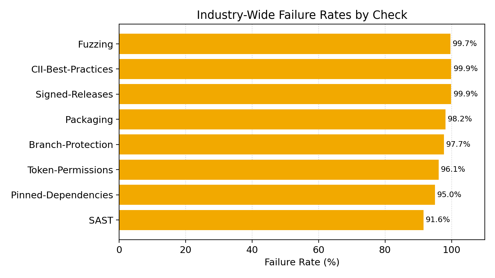

# Marketplace Mirage: Exposing the Security Gap in GitHub's Action Marketplace

**Yi-Tso Huang, Jonathan Kao** 
Purdue University - `{huan1922, kao54}@purdue.edu`

> Original PDF: [`kao huang paper.pdf`](kao%20huang%20paper.pdf)

---

## Table of Contents

- [Abstract](#abstract)
- [1 Introduction](#1-introduction)
- [2 Empirical Threat Landscape](#2-empirical-threat-landscape)
- [3 Design](#3-design)
- [4 Evaluation](#4-evaluation)
- [5 Discussion](#5-discussion)
- [6 Related Work](#6-related-work)
- [7 Conclusion](#7-conclusion)
- [References](#references)

---

## Abstract

Modern software supply chains increasingly rely on GitHub Marketplace *Apps* and *Actions* to automate CI/CD pipelines. This convenience introduces a significant attack surface: over-privileged tokens, unsafe triggers, and unpinned dependencies. Despite rapid adoption, there is a lack of empirical data on whether Marketplace trust signals - such as publisher verification and star counts - serve as reliable proxies for technical security.

We present a large-scale measurement study of Marketplace repositories using a *Security Assessment Framework* that integrates OpenSSF Scorecard metrics with custom workflow analysis [16]. Our findings expose a "Marketplace Mirage": a systemic disconnect where social trust signals are decoupled from technical hygiene. Specifically, we find a near-zero correlation (0.142) between repository stars and security scores, and reveal that 94.99% of analyzed workflows fail to implement immutable dependency pinning. We categorize these risks into a new threat taxonomy and provide an actionable framework for continuous security grading. Our results suggest that Marketplace safety must be measured through objective hardening - rather than social signals.

## 1 Introduction

**General area and problem.** GitHub Marketplace centralizes third-party automation that now permeates development pipelines. However, as established by recent literature, this ecosystem creates a systemic concentration of risk; **Koishybayev et al.** found that 97% of analyzed repositories execute at least one Action from an unverified creator, potentially exposing them to unvetted code [10]. Recent empirical evidence reveals a widespread state of over-privilege, with 99.8% of workflows operating with read-write access by default. Despite these measurable technical risks, developers continue to fall into a "social signal trap," relying on stars or Marketplace "verification" badges as primary proxies for safety. These signals create a false sense of security that we term the "Marketplace Mirage." Our study proves that these signals are statistically decoupled from technical reality, identifying a negligible correlation of 0.142 between repository stars and objective security scores.

**Limits of prior work.** While industry reports have begun to document the general insecurity of the Actions ecosystem - noting that unverified listings often suffer from poor maintenance - there remains a critical integration gap in existing academic literature. Prior work either provides platform-wide statistics on token over-privilege or focuses on detecting specific injection vulnerabilities, but did not systematically quantify the statistical correlation between Marketplace trust signals and objective technical hygiene. Without this data-driven linkage, the community lacks an empirical basis to challenge the assumption that popular or verified listings are inherently safer.

**Goal and vision.** Our goal is a comprehensive, data-driven portrait of Marketplace risk that moves beyond popularity or verification toward measurable indicators of security posture. We envision a repeatable assessment framework that continuously scores Marketplace artifacts and usage, guiding maintainers toward impactful fixes and informing platform policy (e.g., safer defaults, permission gating).

**In this paper.** We present a measurement study of 16,819 GitHub Marketplace artifacts. We (1) systematically enumerate the marketplace to collect 25,805 action slugs and link them to 25,697 unique public repositories; (2) assess their security posture using the OpenSSF Scorecard automated security analysis tool, obtaining 16,819 scorecard results across 18 security dimensions; (3) analyze the correlation between security scores, marketplace trust signals (verification badges and star counts), and vulnerability patterns.

**Major results.** Our evaluation of 16,819 Marketplace Actions reveals systemic security deficiencies across the GitHub Actions Marketplace:

- **Popularity is not Protection:** We identify a negligible correlation ($r = 0.142$) between repository star counts and technical security scores, proving that social adoption is a poor predictor of actual safety.
- **Systemic Hardening Gaps:** The ecosystem suffers from widespread negligence of basic security hygiene, with 96.08% of Actions failing proper token-permission scoping, 94.99% failing to pin dependencies by hash, 93.93% lacking even a basic security policy file (`SECURITY.md`), and 97.72% operating without branch protection. These trivial-to-implement controls - requiring only configuration changes or a single documentation file - demonstrate systemic security negligence driven by absent marketplace listing requirements, inadequate developer education, and lack of enforcement mechanisms.
- **The Verification Premium:** While verified publishers maintain a 42.95% higher average security posture than unverified ones (4.46 vs 3.12 out of 10), they still experience alarmingly high failure rates. Specifically, 90.79% fail token-permissions checks, 89.26% lack dependency pinning, and 27.48% still contain critically dangerous workflows. The verification premium is most pronounced in Security-Policy (4.63 vs 0.45 out of 10) and Code-Review (4.02 vs 0.53 out of 10), yet even verified Actions demonstrate poor absolute scores (4.63/10 and 4.02/10 respectively).
- **High-Risk Popularity:** We identify 52 high-risk Actions that possess over 1,000 stars yet score below 5.0/10. These include widely adopted Actions like `lowlighter/metrics` (15,721 stars, 4.0/10), `peaceiris/actions-gh-pages` (5,161 stars, 3.3/10), and `SamKirkland/FTP-Deploy-Action` (4,666 stars, 3.3/10). Conversely, only 125 Actions (0.74%) achieve scores $\geq 7.0$, with the best performer `haskell-actions/hlint-scan` (9.6/10) having merely 23 stars, further validating the "Marketplace Mirage" where visibility and safety remain fundamentally decoupled.

**Contributions.** This paper makes the following contributions to the field of software supply chain security:

- **Threat Taxonomy & Dataset:** We define a multi-dimensional threat taxonomy for GitHub Actions and provide a curated dataset of 16,819 Marketplace-linked repositories, linking social metadata to technical security attributes.
- **Security Assessment Framework:** We design and implement a repeatable framework that operationalizes OpenSSF Scorecard metrics to grade the security hygiene of the Marketplace ecosystem, identifying critically systemic failures.
- **The Marketplace Mirage Analysis:** We provide the first formal empirical analysis of the correlation between Marketplace trust signals and security posture. We identify a "Social Signal Disconnect" by revealing a negligible correlation ($r = 0.142$) between star counts and security hygiene.
- **Ecosystem Risk Profiling:** We characterize the "Multiplier Effect" through a comparative study of verified vs. unverified publishers, identifying a high-risk tier of 52 popular Actions that possess high social trust despite significant security maintenance deficits.

The remainder of this paper proceeds as follows. Section 2 analyzes the empirical threat landscape and characterizes recent vulnerabilities in the marketplace. Section 3 describes the design of our assessment workflow. Section 4 presents our quantitative evaluation and interprets the experimental data. Section 5 examines our research assumptions and suggests directions for future work. Section 6 situates our work in the related literature. Section 7 concludes.

## 2 Empirical Threat Landscape

The security landscape of GitHub Actions is defined by a "Fidelity Gap," where robust platform-level defenses are undermined by flaws in how individual Actions are built. Although GitHub provides a highly secure and isolated environment for running code, our study of security incidents from 2022 to 2025 reveals that the third-party ecosystem remains unstable and high-risk. During this period, we identified 38 unique, reviewed security incidents specifically targeting Marketplace Actions or their common implementation patterns.

Our analysis reveals a distinct correlation between publisher status and attack methodology. As shown in Table 2, while verified publishers account for only 37% of unique incidents, they represent the vast majority of the ecosystem's "blast radius." High-profile compromises of verified publishers, such as those involving *reviewdog* or *tj-actions*, demonstrate a strategic shift by attackers to exploit the "Multiplier Effect" - targeting tools used in tens of thousands of downstream pipelines to maximize data exfiltration.

In contrast, unverified community Actions account for 63% of documented cases. These are primarily high-frequency, "silent" vulnerabilities - such as unsanitized input interpolation (CWE-94) and over-privileged token defaults - discovered through automated scanning by the GitHub Security Lab (GHSL). These findings validate our hypothesis that "Popularity is not Protection": high star counts often mask critical hygiene gaps. Their root causes, and their technical impacts are summarized in Table 1.

**Table 1: Systematic Vulnerability Categories in Marketplace Actions (2023-2025)**

| Attack Vector | Key CVE Case(s) | Technical Impact & Blast Radius |
| --- | --- | --- |
| **Supply Chain Poisoning** | CVE-2025-30154 | **Account Takeover:** Malicious code injected into *reviewdog/action-setup* to exfiltrate secrets, impacting all downstream linting tools. |
| **Cache Secret Exposure** | CVE-2023-30853 | **Cache Poisoning:** Insecure writing of data to the Actions Cache in *gradle-build-action*, allowing secrets to be exposed to other workflows. |
| **Artifact Leakage** | CVE-2025-24362 | **Information Disclosure:** Debug artifacts in *github/codeql-action* failing to redact environment variables, leaking secrets in failed runs. |
| **Input Injection** | CVE-2023-49291 | **RCE via Syntax:** Unsanitized expansion of branch names in shell commands within *tj-actions*, allowing arbitrary code execution. |
| **Arbitrary File Write** | CVE-2024-42471 | **Path Traversal:** Vulnerability in *actions/artifact* toolkit allowing malicious artifacts to overwrite system binaries on the host runner. |

**Table 2: Verified vs. Unverified Marketplace Actions with Reviewed Security Advisories (2022-2025)**

| Publisher Marketplace Status | Cases |
| --- | ---: |
| Verified Publishers | 14 |
| Unverified Publishers | 24 |
| **Total Reviewed Advisories** | **38** |

## 3 Design

We conducted a comprehensive empirical study of the GitHub Actions Marketplace ecosystem to evaluate the relationship between social signals (popularity and verification status) and technical security quality. Our methodology consists of five sequential phases: marketplace enumeration, metadata collection, categorization, security assessment, and comparative analysis.

### 3.1 Phase 1: Marketplace Enumeration

We developed a web crawler to systematically enumerate all publicly listed Actions in the GitHub Actions Marketplace. The crawler navigates category pages on `github.com/marketplace?type=actions`, extracting marketplace slugs (unique identifiers for Actions) from paginated listings. This enumeration phase collected 25,805 marketplace slugs, providing comprehensive coverage of the publicly accessible marketplace.

### 3.2 Phase 2: Metadata Collection

For each enumerated marketplace slug, we collected detailed metadata through asynchronous HTTP requests to action marketplace pages, extracting:

- **Repository metadata:** Owner, name, and GitHub URL
- **Popularity metrics:** Star count as a proxy for community adoption
- **Verification status:** Verified creator badge indicator
- **Action metadata:** Description, category, and marketplace details

This phase successfully processed 25,702 actions (99.6%), excluding 103 actions with invalid, deleted, or private repository links.

### 3.3 Phase 3: Dataset Categorization and Filtering

We performed data cleaning and categorization to prepare the dataset for security analysis:

1. **Deduplication:** Since a single repository may publish multiple marketplace actions, we deduplicated by repository identifier (`owner/name`).
2. **Verification categorization:** We partitioned repositories into verified and unverified categories based on the creator badge status.
3. **Popularity ranking:** Within each category, we sorted repositories by descending star count to enable stratified analysis of high-visibility actions.

After deduplication, our dataset comprises 25,697 unique repositories: 987 (3.8%) verified and 24,710 (96.2%) unverified.

### 3.4 Phase 4: Security Assessment via OpenSSF Scorecard

We queried the OpenSSF Scorecard API for pre-calculated results. Since OpenSSF scans the majority of public GitHub repositories weekly, the API provides near-instantaneous retrieval for previously analyzed repositories. Of the 25,697 repositories queried, 16,819 had available scorecard results (65.5% coverage): 717 verified (72.6% of verified repositories) and 16,102 unverified (65.2% of unverified repositories). The remaining 8,878 repositories had not yet been scanned by OpenSSF's weekly scanning infrastructure.

Future work will compute scorecards for these remaining repositories using the local OpenSSF CLI tool to achieve complete coverage.

### 3.5 Phase 5: Comparative Statistical Analysis

We conducted comprehensive statistical analysis on the 16,819 repositories with scorecard results to quantify security disparities between verified and unverified actions and assess the relationship between popularity and security quality.

#### 3.5.1 Descriptive Statistics

For each category (verified and unverified), we computed:

- Mean, median, and standard deviation of overall scorecard scores
- Per-check score distributions across all 18 security dimensions
- Failure rate analysis, defining failure as scoring below 5.0 on any check
- Score distribution categorization: excellent (8-10), good (6-7.9), moderate (4-5.9), poor (0-3.9)

#### 3.5.2 Correlation Analysis

We calculated Pearson correlation coefficients between star count and security scores to test the hypothesis that popularity predicts security quality. Correlation was computed separately for:

- Verified actions ($n = 717$)
- Unverified actions ($n = 16{,}102$)
- Combined dataset ($n = 16{,}819$)

Correlation strength interpretation follows standard thresholds: $|r| < 0.3$ (weak), $0.3 \leq |r| < 0.7$ (moderate), $|r| \geq 0.7$ (strong).

#### 3.5.3 Verification Impact Quantification

For each security check, we measured the "verification premium":

- **Absolute score difference:** $`\Delta_{\text{check}} = \text{mean}_{\text{verified}} - \text{mean}_{\text{unverified}}`$
- **Relative improvement:** $`\dfrac{\Delta_{\text{check}}}{\text{mean}_{\text{unverified}}} \times 100\%`$
- **Failure rate reduction:** Percentage point decrease in failure rates for verified vs. unverified

#### 3.5.4 Risk Profiling

We identified high-risk subsets based on the intersection of popularity and poor security:

- **High-risk popular actions:** Repositories with $\geq 1{,}000$ stars and overall score $< 5.0$
- **Low-risk high-security actions:** Repositories with overall score $\geq 7.0$, regardless of popularity
- **Outlier detection:** Actions scoring $> \mu + 2\sigma$ (exceptional performers) or $< \mu - 2\sigma$ (exceptional failures)

#### 3.5.5 Failure Root Cause Analysis

For each security check, we aggregated failure reasons from Scorecard's diagnostic output. By normalizing reason strings (e.g., replacing specific numeric counts with placeholders like "X"), we identified the most prevalent security shortcomings and determined whether failure patterns differ systematically between verified and unverified repositories.

This five-phase methodology enables systematic, reproducible security assessment across the GitHub Actions Marketplace ecosystem, providing empirical evidence for the "Marketplace Mirage" phenomenon where social signals fail to predict technical security quality.

## 4 Evaluation

The evaluation of the GitHub Marketplace ecosystem centers on the relationship between social trust signals, publisher verification, and objective technical security hygiene. We utilize the OpenSSF Scorecard to provide an automated, multi-dimensional grading of these repositories across 18 distinct security checks.

### 4.1 Verification Impact and Security Posture

Our analysis confirms that publisher verification is a positive indicator of security quality, although absolute security scores remain low across the entire ecosystem.

   
  <em>Figure 1: Average OpenSSF Scorecard score for verified and unverified GitHub Actions.</em>

**Overall Scores:** Verified Actions maintain an average security score of 4.46, which is 1.34 points (42.95%) higher than the 3.12 average observed in unverified Actions.

The distribution of these scores reveals a stark contrast in risk profiles between the two groups:

- **Verified Distribution:** 44.35% (318 repos) score in the moderate range (4.0-5.9), while 40.17% (288 repos) are classified as poor (0.0-3.9). Only 2.09% (15 repos) achieve an "excellent" rating (8.0-10.0).
- **Unverified Distribution:** A significant 87.31% (14,058 repos) of unverified Actions fall into the "poor" category, with only 0.20% (32 repos) reaching an excellent rating.

   
  <em>Figure 2: Distribution of OpenSSF Scorecard scores by verification status.</em>

| Score band | Verified ($n = 717$) | Unverified ($n = 16{,}102$) |
| --- | ---: | ---: |
| Excellent (8-10) | 15 (2.09%) | 32 (0.20%) |
| Good (6-7.9) | 96 | 195 |
| Moderate (4-5.9) | 318 (44.35%) | 1,817 |
| Poor (0-3.9) | 288 (40.17%) | 14,058 (87.31%) |

The impact of verification is most pronounced in administrative and organizational security practices. Verified Actions hold a significant premium in:

- **Security-Policy:** A +4.18 point premium (4.63 vs 0.45), representing a 920.71% improvement for verified publishers.
- **Code-Review:** A +3.49 point advantage (4.02 vs 0.53).
- **Maintained:** Maintenance hygiene scores are 1.68 points higher (2.28 vs 0.60) for verified listings.
- **SAST:** Implementation of static analysis is 1.32 points higher (1.97 vs 0.66) in the verified tier.

   
  <em>Figure 3: Checks where verified actions score higher.</em>

Overall, verified actions score higher than unverified ones in 17 out of 18 checks, indicating that verification provides consistent security benefits rather than isolated improvements.

### 4.2 The Marketplace Mirage: Popularity vs. Security

A central finding of this study is the near-total disconnect between an Action's popularity and its technical security quality, a phenomenon we define as the "Marketplace Mirage."

- **Correlation Analysis:** The overall correlation between star counts and security scores is only 0.142, indicating a very weak positive relationship.
- **Persistence of Disconnect:** This disconnect persists across both categories, with a correlation of 0.191 for verified Actions and 0.106 for unverified Actions.
- **High-Risk Popularity:** We identified 52 high-risk Actions possessing $\geq 1{,}000$ stars yet maintaining a failing security score below 5.0. Notable examples include *lowlighter/metrics* (15,721 stars, score: 4.00) and *mikefarah/yq* (14,499 stars, score: 4.90).

### 4.3 Systemic Ecosystem Failures

Despite the relative advantage of verified Actions, the entire ecosystem still suffers from critical failure rates. 11 critical checks exhibit an overall failure rate exceeding 75%. Systemic gaps are particularly evident in technical configuration:

- **Least Privilege:** 96.08% of all Actions fail the Token-Permissions check, often due to excessive default permissions. This rate remains high at 90.79% even among verified Actions.
- **Dependency Management:** 94.99% of Actions fail to pin dependencies by hash, including 89.26% of verified Actions.
- **Advanced Hardening:** Critical practices such as Fuzzing (99.73%) and Signed-Releases (99.86%) are almost non-existent in the current Marketplace landscape.

   
  <em>Figure 4: Industry-wide failure rates by OpenSSF Scorecard check (sorted descending).</em>

## 5 Discussion

Our empirical study of 16,819 GitHub Actions reveals systemic security deficiencies across the marketplace ecosystem, demonstrating that social signals (popularity and verification status) fail to predict technical security quality. This section discusses the key assumptions underlying our methodology, acknowledges study limitations, and outlines directions for future work.

### 5.1 Key Assumptions and Their Implications

#### 5.1.1 OpenSSF Scorecard as Security Proxy

We adopt OpenSSF Scorecard as the authoritative measure of repository security posture. This choice carries several implicit assumptions:

**Assumption 1: Automated checks capture meaningful security practices.** Scorecard evaluates 18 dimensions of software supply chain security, including code review, dependency management, and vulnerability disclosure. While these checks are industry-standard best practices endorsed by the OpenSSF, they represent *observable security hygiene* rather than the absence of vulnerabilities. A repository scoring 10/10 may still contain exploitable bugs; conversely, a repository scoring poorly may have strong runtime security controls not captured by static analysis.

**Assumption 2: Public repository artifacts reflect actual security practices.** Scorecard analyzes public GitHub metadata (commit histories, workflow configurations, release artifacts). Organizations may employ additional private security measures (internal code review, proprietary SAST tools, manual security audits) invisible to automated analysis. Our findings thus represent a *lower bound* on security investment, potentially underestimating actual security rigor for repositories with non-public practices.

**Assumption 3: Scorecard checks are equally weighted.** We report aggregate scores averaging across all 18 checks, treating each dimension as equally important. In practice, certain checks (e.g., Token-Permissions, Pinned-Dependencies) may have disproportionate security impact for CI/CD contexts, while others (e.g., CII-Best-Practices badge) may reflect bureaucratic compliance more than technical rigor. Future work could apply domain-specific weighting to prioritize checks most relevant to GitHub Actions security.

#### 5.1.2 Star Count as Popularity Proxy

We use GitHub star count as the sole measure of action popularity and community trust. This assumption has notable limitations:

**Assumption 4: Stars reflect adoption and trust.** Stars may indicate genuine usage, but can also reflect promotional activity, historical popularity of deprecated projects, or inflated counts from bot networks. More direct usage metrics (workflow adoption counts, download statistics) would provide stronger evidence of actual deployment, but such data is not publicly available at scale.

**Assumption 5: Popularity remains stable over time.** Our snapshot-based analysis captures star counts at a single point in time. Actions may gain or lose popularity, and security postures may improve or degrade. Longitudinal analysis tracking temporal evolution would better characterize security trajectory relative to adoption trends.

#### 5.1.3 Verification Badge as Trust Signal

We treat GitHub's verified creator badge as a binary trust indicator, assuming verified publishers represent higher-quality, more trustworthy actions. However:

**Assumption 6: Verification implies security commitment.** The verification process validates publisher identity but does not mandate security practices. Our findings confirm this: verified actions score 42.95% higher on average, yet still exhibit catastrophic failure rates (90.79% fail token-permission checks, 89.26% lack dependency pinning). Verification establishes *accountability*, not *security competence*.

### 5.2 Study Limitations

#### 5.2.1 Incomplete Scorecard Coverage

Of 25,697 unique repositories, only 16,819 (65.5%) had pre-calculated OpenSSF Scorecard results available via API. The remaining 8,878 repositories (34.5%) were not yet scanned by OpenSSF's weekly infrastructure, introducing potential selection bias:

- **Recency bias:** Newly published actions may lack scorecard data, skewing our sample toward established repositories.
- **Activity bias:** OpenSSF prioritizes scanning active, popular repositories. Low-star, unmaintained actions may be underrepresented in scorecard coverage.
- **Verification bias:** Verified repositories achieved higher coverage (72.6%) than unverified ones (65.2%), potentially inflating verified scores if missing repositories trend toward lower security.

Future work will address this limitation by computing scorecards locally via the OpenSSF CLI for all 8,878 missing repositories, ensuring complete ecosystem coverage and eliminating selection bias.

#### 5.2.2 Cross-Sectional Design

Our study captures a single snapshot of the marketplace ecosystem. This design cannot assess:

- **Security trajectory:** Whether repositories improve or degrade security posture over time
- **Temporal causality:** Whether verification precedes security improvement or follows it
- **Incident response:** How quickly repositories patch vulnerabilities or adopt new security practices

Longitudinal analysis tracking scorecard evolution would reveal whether marketplace incentives (stars, verification) motivate security investment or merely correlate with pre-existing quality.

#### 5.2.3 Correlation vs. Causation

Our correlation analysis ($r = 0.142$ between stars and security) demonstrates that popularity does not predict security quality, but cannot establish causal mechanisms. Possible explanations include:

- **Misaligned incentives:** Developers optimize for functionality and ease-of-use rather than security hygiene
- **Invisible security:** Users cannot easily assess security quality, defaulting to popularity heuristics
- **Path dependency:** Early-adopter actions accumulate stars before security best practices were codified
- **Effort asymmetry:** Security hardening requires ongoing effort; popularity stems from one-time feature delivery

Qualitative research (developer interviews, marketplace policy analysis) would illuminate the sociotechnical factors driving the "Marketplace Mirage" phenomenon.

### 5.3 Implications and Future Work

#### 5.3.1 Marketplace Platform Interventions

Our findings reveal systemic negligence of trivial-to-implement security controls (96.08% fail token-permissions, 93.93% lack security policies). This suggests marketplace-level interventions could dramatically improve ecosystem security:

**Recommendation 1: Minimum security requirements for marketplace listing.** GitHub could establish mandatory security checks for marketplace publication, automatically rejecting actions that fail critical security criteria such as proper token-permission scoping, dependency pinning, or security policy documentation. Such requirements could be implemented through GitHub's own automated analysis tools or by integrating existing security frameworks, setting baseline thresholds that all published actions must meet.

**Recommendation 2: Surfacing security metadata in marketplace UI.** GitHub should display security assessment results prominently alongside each action listing, enabling users to make informed security choices and creating market pressure for security investment. This could include security scores, check results, or badges indicating compliance with security best practices. Current marketplace listings prioritize stars and descriptions, rendering security completely invisible to users.

**Recommendation 3: Security requirements for verified publisher badge.** GitHub's verified creator badge is currently awarded through an unclear, manual review process that validates publisher identity but imposes no security requirements. Despite carrying the implied trust signal of "verification," these publishers exhibit failure rates of 90.79% for token-permissions and 89.26% for dependency pinning. GitHub should reform the verification process to include mandatory security assessments, requiring demonstrated compliance with security best practices for initial badge issuance and periodic re-certification to maintain verified status. This would transform verification from a hollow identity check into a meaningful security certification.

#### 5.3.2 Vulnerability-Scorecard Correlation Analysis

While our study assesses *preventive* security practices via scorecard, it does not directly measure *actual vulnerabilities*. Future work should:

- Cross-reference our dataset with CVE/GHSA databases to identify publicly disclosed vulnerable actions
- Cross-reference with vulnerabilities discovered by research tools such as ARGUS [13], which performs staged static taint analysis to detect workflow injection and other GitHub Actions vulnerabilities
- Correlate vulnerability presence with low scorecard scores to validate predictive power
- Analyze which scorecard checks (Token-Permissions, SAST, etc.) most strongly predict vulnerability absence
- Quantify the security ROI of specific hardening practices

We have initiated this analysis by collecting 84 GitHub Actions-related vulnerabilities from NVD and GHSA databases, manually categorizing them by OpenSSF Scorecard check. Preliminary findings indicate SAST (62 vulnerabilities), Token-Permissions (41), and Dangerous-Workflow (30) as the most relevant preventive checks. Complete vulnerability-scorecard correlation analysis remains ongoing.

#### 5.3.3 Dependency Security and Transitive Risk

GitHub Actions compose dependencies (third-party actions, libraries, container images), creating transitive security risks. Our scorecard analysis evaluates repository-level practices but does not assess:

- **Action composition security:** Whether actions depend on insecure third-party actions
- **Supply chain depth:** Recursive dependency vulnerability propagation
- **Pinning enforcement:** Whether Pinned-Dependencies check truly prevents supply chain attacks

Future work could construct dependency graphs for all marketplace actions, identifying high-risk compositions and quantifying supply chain exposure beyond single-repository analysis.

#### 5.3.4 Developer Education and Tooling

Our failure root cause analysis reveals that 96.08% of actions fail token-permission scoping and 94.99% lack dependency pinning - trivial configuration changes. This points to a *knowledge gap* rather than technical difficulty. Future work should:

- Develop automated linters integrated into GitHub Actions workflows to detect and remediate common security misconfigurations
- Design educational campaigns explaining the security implications of excessive token permissions and unpinned dependencies
- Provide GitHub Actions templates with secure-by-default configurations
- Evaluate the effectiveness of automated pull requests suggesting scorecard improvements

Tooling that makes secure practices the *path of least resistance* could address the systemic negligence our study documents.

#### 5.3.5 Comparative Ecosystem Analysis

GitHub Actions represent one CI/CD marketplace among many (GitLab CI, CircleCI, Jenkins plugins, Azure Pipelines). Comparative analysis would reveal whether the "Marketplace Mirage" generalizes across platforms or reflects GitHub-specific governance failures. Cross-ecosystem studies could identify best practices from platforms with stronger security outcomes and inform evidence-based policy recommendations.

### 5.4 Broader Implications for Software Supply Chains

Our findings contribute to the growing body of evidence that *social signals fail to predict software security*. The GitHub Actions Marketplace exemplifies a broader pattern where:

- **Popularity diverges from security:** Stars, downloads, and endorsements do not correlate with technical rigor
- **Trust signals are hollow:** Verification badges and organizational affiliations do not guarantee secure practices
- **Security remains invisible:** Without automated assessment and prominent disclosure, users default to popularity heuristics

As software supply chains grow increasingly complex and dependencies proliferate, relying on social proxies for security creates systemic risk. Our study demonstrates that technical measurement (OpenSSF Scorecard), transparent disclosure (scorecard badges), and enforceable standards (minimum security thresholds) are necessary to align marketplace incentives with security outcomes.

The "Marketplace Mirage" - where visibility masquerades as safety - poses a fundamental challenge to open-source ecosystems. Addressing it requires platform-level intervention, developer education, automated tooling, and a cultural shift toward treating security as a first-class marketplace criterion alongside functionality and ease-of-use.

## 6 Related Work

The security landscape of software development platforms has evolved dramatically as third-party ecosystems and automated workflows have become integral to modern development practices. This transformation raises critical security questions that span multiple domains: marketplace applications, continuous integration systems, and extensible development environments. Our work on GitHub Marketplace *Apps* and *Actions* builds upon a rich foundation of research examining these security challenges across platforms and ecosystems.

### 6.1 Security of Automated Workflows and CI/CD (Threats and Analysis)

GitHub Actions (GHA) is now deeply embedded in development workflows, with large-scale ecosystem studies documenting rapid uptake, extensive reuse of third-party Actions, and the resulting concentration of dependency risk [7, 5]. Recent literature has established a robust taxonomy of the CI/CD threat model. **Koishybayev et al.** analyzed over 447,000 workflows and identified four fundamental security properties: Admittance, Execution, Code Control, and Access to Secrets [10]. Their findings highlight a systemic over-privilege issue, with 99.8% of workflows possessing read-write access by default, and 97% of repositories executing at least one Action from an unverified creator [10].

From a vulnerability-analysis perspective, Muralee et al.'s *ARGUS* demonstrates the prevalence of command and code-injection flows in Actions and reusable workflows, showing that taint-based analyses uncover many classes of injection that pattern-based scanners miss [13]. Beyond injection, recent work examines configuration quality and failure modes, as well as resource-usage optimization opportunities [27, 4]. Hassan et al. expanded this by scanning 8,107 JavaScript Actions, finding that 54% contained at least one security weakness (CWE), often originating from vulnerabilities in "indirect dependencies" within deep npm packages [15]. Furthermore, research by OpenSSF and Cycode details exploitation techniques such as "Pwn Requests," where attackers use pull requests from forks to abuse privileged `workflow_run` triggers to exfiltrate secrets or poison build artifacts [17].

Stepping back, project hygiene remains a significant barrier to security. Ayala and Garcia found that while 57% of popular repositories utilize workflows, only 17% maintain a formal security policy, with extremely low adoption rates for automated scanning tools like CodeQL [3]. Despite these measurable risks, a survey-based study found that developers often fall into a "social signal trap," using star counts and verified badges as primary trust indicators despite lacking the tools for deep security audits [6]. Our study differs by correlating these measured technical risks - such as the 0.142 correlation we identified between stars and security scores - directly with these Marketplace-level trust signals.

### 6.2 Lessons from Extension Marketplaces

The browser and IDE extension ecosystems provide a close analogue for understanding third-party permission governance at marketplace scale. Empirical studies in these domains show systematic over-privilege and least-privilege non-compliance, alongside the ability for extensions to expand capabilities post-installation [19, 1]. **Lin et al.** demonstrate that the VS Code extension model grants broad host access, allowing vulnerabilities to enable secret exfiltration and lateral movement [11]. These patterns map directly to our setting: Marketplace Apps request repository scopes that often exceed necessity, while Actions inherit transitive risk through third-party updates. These analogous ecosystems suggest that "Verified" status and social signals (like stars) can be noisy or manipulable, justifying our use of objective risk and maintenance indicators rather than social trust [22, 9, 18].

### 6.3 Supply Chain Security and Dependency Management

Integrity frameworks and systematizations of knowledge provide a principled lens for assessing Marketplace risks. *in-toto* formalizes provenance for build pipelines [21], while SoK studies consolidate detection strategies for supply-chain compromise [14]. Because many Actions embed npm packages or chain other Actions, vulnerabilities propagate transitively through technical lag and dependency drift [28, 26, 2]. We specifically draw on repository-level practice signals - such as branch protection, code review requirements, and dangerous-workflow checks - as captured by the **OpenSSF Scorecard** to interpret the maintenance health of Marketplace participants [25].

### 6.4 Third-Party Application Marketplace Security

Work focusing specifically on development-tool marketplaces is emerging. A recent study positions the GitHub Marketplace within software-production automation, cataloging categories and growth and clarifying how third-party tooling integrates into developer workflows - useful context for our adoption measures [20]. More broadly, research on permissioned integrations (OAuth/SSO) documents specification pitfalls and empirical misconfigurations that lead to over-privilege and unintended disclosure [8, 12]. GitHub-centric research further shows how automation affects contributor workflows (e.g., PR coordination), which helps explain how Actions propagate and concentrate across repositories [24, 23]. Finally, adoption and attention metrics can be noisy or manipulable; evidence on badges and stars cautions against equating popularity with trust, which is why we pair adoption with objective risk/health indicators [22, 9].

### 6.5 Gaps in Current Research and Our Contribution

While existing research has thoroughly examined specific CI/CD vulnerabilities and platform-wide misconfigurations, no study has systematically quantified the Marketplace-specific correlation between social trust signals and technical security hygiene. Prior work, such as **Koishybayev et al.**, provides critical statistics on token over-privilege (99.8% failure rate), but focuses on general workflow execution environments rather than the Marketplace's specific publisher governance signals [10]. Similarly, while **Hassan et al.** identified a 54% prevalence of security weaknesses in JavaScript Actions, their analysis does not account for how these technical risks correlate with social adoption metrics [15].

Our research fills this gap by providing a targeted measurement study of 16,819 Marketplace Actions that explicitly links publisher verification and adoption patterns to automated hygiene grading via the OpenSSF Scorecard. We provide the first empirical evidence of a "Social Signal Disconnect" within the ecosystem. By identifying a near-zero correlation ($r = 0.142$) between star counts and security scores, we prove that the Marketplace's primary trust indicators are almost entirely decoupled from technical safety.

Furthermore, our study operationalizes the concept of the **"Marketplace Mirage"**: a systemic threat model where user trust is anchored in social signals, yet technical hardening remains critically low across the ecosystem. While **Chen et al.** qualitatively identified a "social signal trap" through developer surveys [6], our work provides the statistical proof required to challenge this paradigm. Our data reveals that 96.08% of Actions fail basic token-permission checks and 94.99% fail dependency pinning, regardless of their popularity or verification status. By integrating these technical failures with social adoption metrics, our work provides a normative baseline for measuring Marketplace safety through objective hardening rather than perceived trust.

## 7 Conclusion

In this paper, we presented a comprehensive measurement study of 16,819 GitHub Marketplace Actions to evaluate the relationship between social trust signals and technical security hygiene. By operationalizing the OpenSSF Scorecard within a custom Security Assessment Framework, we provided the first statistical verification of the "Marketplace Mirage" - a systemic phenomenon where social adoption metrics (stars) and governance markers (the "Verified" badge) fail to serve as reliable proxies for maintenance health and security hardening.

Our analysis yielded three critical insights. First, we identified a negligible correlation ($r = 0.142$) between star counts and technical security scores, empirically validating the "social signal trap" qualitatively identified in prior surveys [6]. Second, we documented widespread hygiene deficits that persist regardless of popularity; 96.08% of analyzed Actions fail basic token-permission hygiene, and 94.99% fail to implement immutable dependency pinning. Third, while verified publishers maintain a 42.95% higher average security posture than unverified ones (4.46 vs. 3.12), they remain susceptible to the same fundamental configuration failures and dependency risks identified in recent vulnerability scans [15, 17].

These results suggest that the current Marketplace ecosystem lacks the transparency required for safe dependency management. While platform-wide studies have long warned of systemic over-privilege [10], our work proves that the signals developers use to navigate these risks are statistically decoupled from reality. Moving forward, we argue that Marketplace security must shift from a model of perceived trust to one of objective, automated transparency. By providing a normative baseline for measuring security through hardening rather than popularity, our work informs the design of more resilient CI/CD ecosystems and provides a pathway for platform-level policies that prioritize technical reality over the Marketplace Mirage.

## References

1. A. Aggarwal, B. Viswanath, L. Zhang, S. Kumar, A. Shah, and P. Kumaraguru. Analysis and detection of spying browser extensions. In *IEEE European Symposium on Security and Privacy (EuroS&P)*, pages 47-61, 2018.
2. M. Alfadel, D. E. Costa, and E. Shihab. Empirical analysis of security vulnerabilities in python packages. *Empirical Software Engineering*, 2023.
3. J. Ayala and J. Garcia. An empirical study on workflows and security policies in popular github repositories. In *2023 IEEE/ACM 1st International Workshop on Software Vulnerability (SVM)*, pages 6-9. IEEE, May 2023.
4. I. Bouzenia and M. Pradel. Resource usage and optimization opportunities in workflows of github actions. In *Proceedings of the 46th International Conference on Software Engineering (ICSE)*, 2024.
5. G. Cardoen, T. Mens, and A. Decan. A dataset of github actions workflow histories. *MSR Data Showcase (Companion to ICSE/MSR)*, 2024.
6. T. Chen, Y. Zhang, S. Chen, T. Wang, and Y. Wu. Let's supercharge the workflows: An empirical study of github actions. In *2021 IEEE 21st International Conference on Software Quality, Reliability and Security Companion (QRS-C)*, pages 01-10, 2021.
7. A. Decan, T. Mens, P. R. Mazrae, and M. Golzadeh. On the use of github actions in software development repositories. In *IEEE International Conference on Software Maintenance and Evolution (ICSME)*, 2022.
8. D. Fett, R. Küsters, and G. Schmitz. A comprehensive formal security analysis of oauth 2.0. In *ACM CCS*, 2016.
9. S. Koch, D. Klein, and M. Johns. The fault in our stars: An analysis of github stars as an importance metric for web source code. In *MADWeb Workshop (NDSS)*, 2024.
10. I. Koishybayev, A. Nahapetyan, R. Zachariah, S. Muralee, B. Reaves, A. Kapravelos, and A. Machiry. Characterizing the security of GitHub CI workflows. In *31st USENIX Security Symposium (USENIX Security 22)*, pages 2747-2763, Boston, MA, Aug. 2022. USENIX Association.
11. E. Lin, I. Koishybayev, T. Dunlap, W. Enck, and A. Kapravelos. Untrustide: Measuring and exploiting vulnerabilities in vs code extensions. In *NDSS*, 2024.
12. S. G. Morkonda, S. Chiasson, and P. C. van Oorschot. Empirical analysis and privacy implications in oauth-based single sign-on systems. In *ACM CCS*, pages 195-208, 2021.
13. S. Muralee, I. Koishybayev, A. Nahapetyan, G. Tystahl, B. Reaves, A. Bianchi, W. Enck, A. Kapravelos, and A. Machiry. ARGUS: A framework for staged static taint analysis of GitHub workflows and actions. In *32nd USENIX Security Symposium (USENIX Security 23)*, pages 6983-7000, Anaheim, CA, Aug. 2023. USENIX Association.
14. C. Okafor, T. R. Schorlemmer, S. Torres-Arias, and J. C. Davis. SoK: Analysis of software supply chain security by establishing secure design properties. In *SCORED@CCS*, pages 15-24, 2022.
15. H. Onsori Delicheh, A. Decan, and T. Mens. Quantifying security issues in reusable javascript actions in github workflows. In *Proceedings of the 21st International Conference on Mining Software Repositories*, MSR '24, pages 692-703, New York, NY, USA, 2024. Association for Computing Machinery.
16. Open Source Security Foundation. Scorecard.
17. OpenSSF and Cycode. Mitigating attack vectors in GitHub workflows. <https://openssf.org/blog/2024/08/12/mitigating-attack-vectors-in-github-workflows/>, August 2024. Accessed: 2025-12-19.
18. N. Pantelaios, N. Nikiforakis, and A. Kapravelos. You've changed: Detecting malicious browser extensions through their update deltas. In *ACM CCS*, pages 477-491, 2020.
19. P. Picazo-Sanchez, L. O. Martín, G. Schneider, and A. Sabelfeld. Are chrome extensions compliant with the spirit of least privilege? *International Journal of Information Security*, 2022.
20. S. G. Saroar, W. Ahmed, E. Onagh, and M. Nayebi. Github marketplace for automation and innovation in software production. *Information and Software Technology*, 2024. preprint/early access.
21. S. Torres-Arias, H. Afzali, T. K. Kuppusamy, R. Curtmola, and J. Cappos. in-toto: Providing farm-to-table guarantees for bits and bytes. In *USENIX Security*, 2019.
22. A. Trockman, S. Zhou, C. Kästner, and B. Vasilescu. Adding sparkle to social coding: An empirical study of repository badges in the npm ecosystem. In *ICSE*, 2018.
23. M. Wessel, T. Mens, A. Decan, and P. R. Mazrae. The github development workflow automation ecosystems. In *Advances in Computers*. Springer, 2023.
24. M. Wessel, J. Vargovich, M. A. Gerosa, and C. Treude. Github actions: The impact on the pull request process. *Empirical Software Engineering*, 28(6):1-35, 2023.
25. N. Zahan, P. Kanakiya, B. Hambleton, S. Shohan, and L. Williams. Openssf scorecard: On the path toward ecosystem-wide automated security metrics. *IEEE Security & Privacy*, 21(6):76-88, 2023.
26. A. Zerouali, T. Mens, A. Decan, and C. D. Roover. On the impact of security vulnerabilities in the npm and rubygems package dependency networks. *Empirical Software Engineering*, 2022.
27. L. Zheng, S. Li, X. Huang, J. Huang, B. Lin, J. Chen, and J. Xuan. Why do github actions workflows fail? an empirical study. *ACM Transactions on Software Engineering and Methodology*, 2025.
28. M. Zimmermann, C. Staicu, C. Tenny, and M. Pradel. Small world with high risks: A study of security threats in the npm ecosystem. In *USENIX Security*, 2019.
