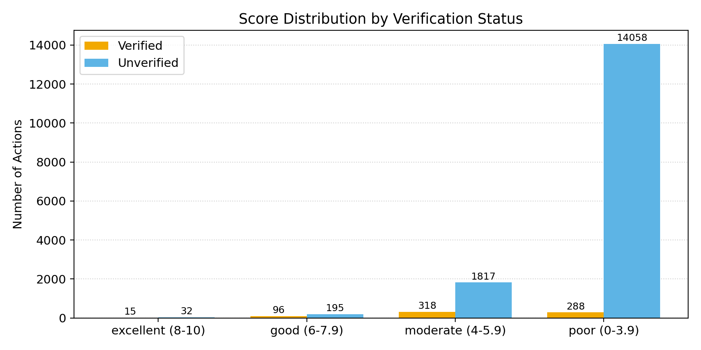
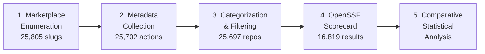

# Marketplace Mirage

**Do GitHub Marketplace trust signals actually tell you whether an Action is secure?**

This repository contains the code, data, and paper for *Marketplace Mirage: Exposing the Security Gap in GitHub's Action Marketplace*. It is a large-scale measurement study of the GitHub Actions Marketplace. We crawled every publicly listed Action, linked it to its source repository, graded each repository with [OpenSSF Scorecard](https://github.com/ossf/scorecard), and tested whether stars and the "Verified creator" badge predict real security hygiene.

The short answer: they mostly don't.

- **Paper (Markdown):** [PAPER.md](PAPER.md)
- **Paper (PDF):** [kao huang paper.pdf](kao%20huang%20paper.pdf)
- **Authors:** Yi-Tso Huang, Jonathan Kao (Purdue University)

<p align="center">
  
</p>

## Key findings

Across **16,819** Marketplace-linked repositories with Scorecard results:

| Finding | Result |
| --- | --- |
| Correlation between stars and security score | **r = 0.142** (negligible) |
| Fail Token-Permissions (least privilege) | **96.08%** |
| Fail to pin dependencies by hash | **94.99%** |
| No security policy (`SECURITY.md`) | **93.93%** |
| No branch protection | **97.72%** |
| Average score, verified vs. unverified publishers | **4.46 vs. 3.12** out of 10 (+42.95%) |
| Popular Actions (1,000+ stars) scoring below 5.0 | **52** |
| Actions scoring 7.0 or higher | **125** (0.74%) |

Verification helps: verified publishers score higher on 17 of 18 checks. But it is not enough. Even among verified publishers, 90.79% fail Token-Permissions and 89.26% do not pin dependencies. The badge confirms who the publisher is, not how securely they build. See [Section 4 of the paper](PAPER.md#4-evaluation) for the full evaluation.

## Methodology



| Step | Script | Output | What it does |
| --- | --- | --- | --- |
| 1 | [`1.marketplace_slugs_crawler.py`](scripts/1.marketplace_slugs_crawler.py) | `1.marketplace_slugs.json` | Walks every category page of `github.com/marketplace?type=actions` and collects Action slugs |
| 2 | [`2.action_repos_crawler.py`](scripts/2.action_repos_crawler.py) | `2.action_repos_data.json` | Fetches each Action's Marketplace page asynchronously, in resumable batches, and extracts the owner, repository, stars, categories, and verified-creator badge |
| 3 | [`3.categorize_verified_sort_stars.py`](scripts/3.categorize_verified_sort_stars.py) | `3.categorized_sorted_repos.json` | Deduplicates by `owner/name`, splits verified from unverified, and sorts each group by stars |
| 4 | [`4.fetch_openssf_scorecards.py`](scripts/4.fetch_openssf_scorecards.py) | `4.openssf_scorecards_results.json` | Pulls precomputed results from the OpenSSF Scorecard API, falling back to the `scorecard` CLI when it is installed |
| 5 | [`5.analyze_scorecard_insights.py`](scripts/5.analyze_scorecard_insights.py) | `5.scorecard_insights.json`, `5.scorecard_insights_summary.txt` | Per-check comparison, Pearson correlation between stars and scores, score bands, failure-reason clustering, risk profiling, and outlier detection |

## Running the pipeline

Requires Python 3.9+.

```bash
pip install -r requirements.txt
```

Each script reads the previous step's output from the current directory, so run them from inside `scripts/`:

```bash
cd scripts
```

```bash
python 1.marketplace_slugs_crawler.py
```

```bash
python 2.action_repos_crawler.py
```

```bash
python 3.categorize_verified_sort_stars.py
```

```bash
python 4.fetch_openssf_scorecards.py
```

```bash
python 5.analyze_scorecard_insights.py
```

Tunables (concurrency, batch size, how many repositories to score) are constants in each script's `main` block. Step 2 saves after every batch and skips slugs it has already processed, so an interrupted crawl can resume where it stopped.

## About the included data

The JSON files in [`scripts/`](scripts) are the outputs of a real run (December 2025) and are included so the analysis can be inspected without re-crawling GitHub.

Steps 1-3 cover the full Marketplace. Step 4 as committed uses `TOP_N = 500`, so it scores only the top 500 verified and top 500 unverified repositories by stars (424 and 447 of them had Scorecard results). Because that subset is popularity-biased, its averages (4.78 vs. 3.97) differ from the paper's full-population numbers (4.46 vs. 3.12, n = 16,819). To reproduce the paper's figures, raise `TOP_N` in `4.fetch_openssf_scorecards.py` so it covers every repository, then rerun steps 4 and 5.

## Repository layout

```
.
├── PAPER.md                 # Full paper in Markdown
├── kao huang paper.pdf      # Original paper (PDF)
├── figures/                 # Figures used in PAPER.md
├── requirements.txt
└── scripts/                 # Five-step pipeline and its outputs
```

## Citation

```bibtex
@misc{huang2025marketplacemirage,
  title  = {Marketplace Mirage: Exposing the Security Gap in GitHub's Action Marketplace},
  author = {Huang, Yi-Tso and Kao, Jonathan},
  year   = {2025},
  note   = {Purdue University}
}
```
